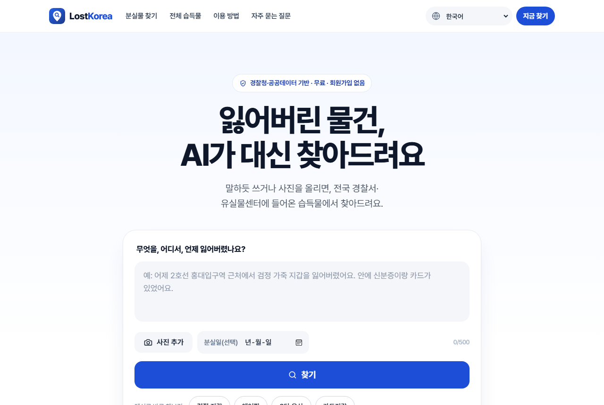
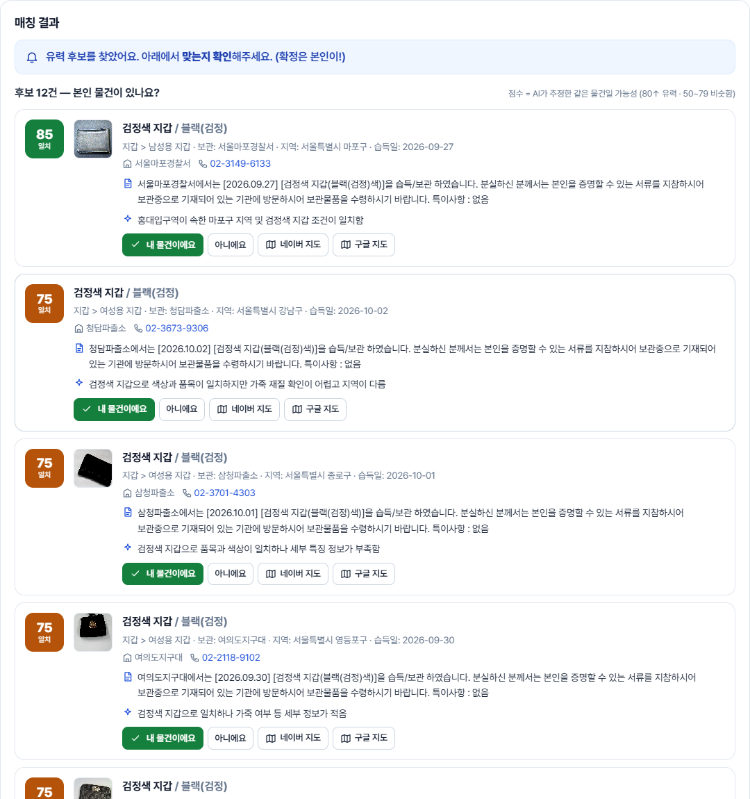
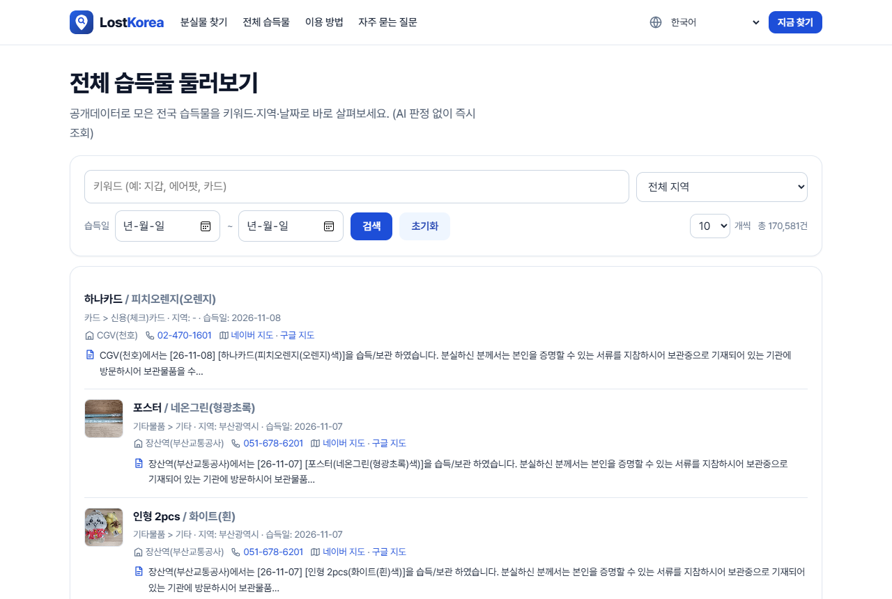
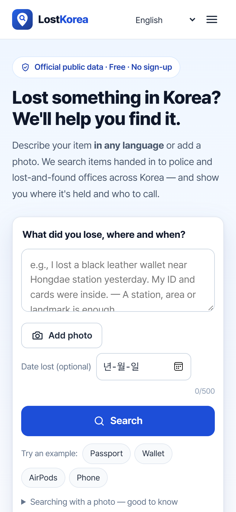
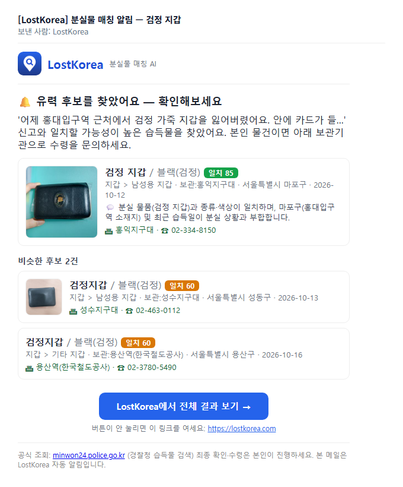
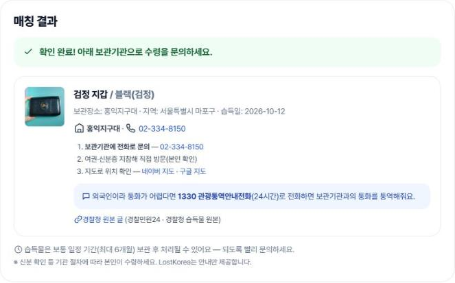

# LostKorea — 한국 분실물 AI 찾기

> 서비스명 변경(2026-11-09): **FindIt → LostKorea** — 같은 이름의 분실물 서비스(AI 매칭 앱 포함)가 이미 여럿 있어 변경.
> GitHub 저장소(`cwal8202/lostkorea`)·DB·컨테이너·서버 경로 등 내부 이름도 lostkorea로(옛 주소는 GitHub가 자동 연결),
> 사이트 주소도 **lostkorea.com**으로(대회용 옛 주소는 새 주소로 자동 이동).

> **해결하는 문제**: 습득물 공개데이터가 있어도 **검색·이용이 불편하다** — 키워드라 표현이 조금만 달라도 못 찾고,
> 매번 직접 뒤져봐야 하며, 잃어버린 장소가 불확실하거나 외국인이면 더 어렵다.

분실물을 **자연어·사진으로** 검색하면, 경찰청·포털 **습득물 공개데이터**에서 **의미 기반(임베딩) + LLM 판정**으로
매칭하고 **근거·수령 안내·알림**까지 주는 서비스. 기존 관공서 검색보다 **더 쉽고 접근성 있게** 분실물을 찾도록.
(외국인 대상 실서비스를 목표로 운영 중 — 코드 품질과 **설계 근거 문서화** 중시)

> 🚀 **라이브**: https://lostkorea.com (영어: [/en](https://lostkorea.com/en))
> — 예: *"어제 서울 2호선에서 검정 지갑 잃어버렸어요"* 검색, **또는 📷 사진 업로드**(Vision 특징추출) →
> 유력 후보 + **근거** + (사진 있으면) 썸네일 → *[내 물건이에요]* 시 보관기관·전화·지도·경찰청 원본 글 안내.
> 🌐 **다국어** — 어떤 언어로 검색해도 결과, 화면·수령안내도 여러 언어(외국인도 이용).
>
> 📄 모든 결정·실험·수치는 [`docs/PROGRESS.md`](docs/PROGRESS.md), 배포는 [`docs/DEPLOY.md`](docs/DEPLOY.md), 서비스화 남은 일은 [`docs/LAUNCH.md`](docs/LAUNCH.md).



*스크린샷은 모두 2026-11-13 운영 사이트를 그대로 캡처(검색 결과·메일은 실제 습득물 데이터, 캡처용 신고는 바로 삭제 — 수령 안내는 확인 처리 없이 화면만).*

---

## 왜 LostKorea? (경찰민원24·lost112 대비)

공식 서비스도 습득물 검색·신고·알림을 한다. LostKorea는 그 **공개데이터 위에, 훨씬 쉽고 정확하게 찾도록 "접근성"을 얹는다**:

- **말하듯 검색 + 의미 매칭** — *"어제 2호선에서 검정 지갑"* 처럼 자연어로. 키워드가 아니라 **뜻**으로 찾아 표현이 달라도·오타·한↔영 커버(BM25 MRR 0.63 → 임베딩 **0.96**).
- **왜 후보인지 근거(LLM) + 📷 사진 검색(Vision)** — 목록만 주는 관공서와 달리 **판단 근거**·사진 대조까지.
  AI가 **무엇을 하는지(추출→지역→검색→판정) 실시간으로 보여주고**, 판정 전 후보부터 먼저 띄움.
- **장소가 불확실해도** — 노선 경유 지역까지 넓혀 순위에 반영하고 *왜* 그 지역들을 봤는지 **설명**.
- **안 찾아봐도 알림** — 신고를 저장해두면 새 습득물 유입마다 자동 재매칭 → **이메일 알림**(알림 기간·약한 후보 알림은 사용자가 설정).
  메일 버튼은 **그 신고의 결과로 바로** 열려서 다른 기기에서도 후보 확인·[내 물건이에요]까지 이어짐.
- **지금 보관 중인 것만** — 매일 경찰 목록과 대조해 주인에게 돌아간(종결) 습득물은 빼고, 내려간 사진도 반영.
  전체 습득물은 **사진 있는 것만·오래된순** 보기, 특이사항과 **경찰청 원본 글** 링크까지(조건은 주소에 남아 링크로 공유).
  사진은 서버가 줄인 **작은 미리보기(원본 ~3MB → ~10KB)**로 — 로밍 중인 휴대폰 데이터 절약.
- **다국어(외국인 접근성)** — 관공서는 한국어로만 검색되지만(영어로 치면 0건), LostKorea는 **어떤 언어로 검색해도** 결과 + 화면·수령안내 다국어.

> 포지셔닝: 관공서 데이터를 **대체가 아니라 보완** — 더 똑똑한 검색·매칭 + 접근성 레이어. 실제 수령·권리는 관공서 소관 → **HITL(사용자 확인)** 유지.

---

## 📸 화면

| AI 매칭 결과 (일치 점수·근거·보관기관·전화·지도·원본 글) | 전체 습득물 (사진 미리보기·사진 있는 것만·정렬·원본 글) |
|:---:|:---:|
| [](docs/screenshots/ai-match.png) | [](docs/screenshots/browse.png) |
| **영어 화면** (휴대폰 · 외국어 브라우저는 자동 이동) | **알림 메일** (같은 검색 결과로 만든 실제 메일 HTML) |
| [](docs/screenshots/multilingual.png) | [](docs/screenshots/email.png) |

| [내 물건이에요] → 수령 안내 (전화·여권 지참·네이버/구글 지도·1330 통역·경찰청 원본 글) |
|:---:|
| [](docs/screenshots/retrieval.png) |

---

## 현재 상태

**✅ 동작하는 전체 파이프라인** (자연어 신고 → 매칭 → 저장 → 지속 재매칭 → 알림 → 웹)
```
수집기(data.go.kr, 매일 최근 7일 + 경찰 목록 대조 + 늦은 등록 채우기) → OpenSearch 색인 → 검색+지역가점 → LLM grading → 매칭 에이전트(LangGraph)
                                                                                  ↓ (단계별 SSE)
              웹 화면 ← 알림(Notifier·이메일) ← 지속 재매칭 ← 분실물 DB(PostgreSQL / 로컬 SQLite)
```
- **매칭 에이전트**: `POST /lost-items`(자연어 한 줄 → 매칭) · `POST /lost-items/image`(📷 사진 → Vision 특징추출 → 매칭)
  · 웹은 `…/stream`(SSE)으로 **추출 → 지역 → 검색어 → 검색 → 판정을 실시간 표시**(판정 전 후보를 먼저 보여줌)
- **전체 둘러보기**: `GET /found-items/browse` — 키워드·지역·날짜 필터 + 최신순 목록(임베딩·LLM 없이 즉시)
- **웹**: 홈 첫 화면에서 바로 검색(글·사진) → 실시간 진행 → 매칭 결과(일치 점수·근거·썸네일·보관기관·지도) → HITL 확인 → 수령 안내, 결과 화면에서 이메일 알림 설정, '내 신고'(이 브라우저) · 전체 습득물(`/browse`) · 영어 가이드(`/en/guide`)
- **다국어**: 어떤 언어로 검색해도 결과(서버가 검색어 번역) + **영어 화면 직접 제공**([/en](https://lostkorea.com/en), 외국어 브라우저는 자동 이동) + 그 밖의 언어는 Google 번역 위젯(필요할 때만 로딩) + **알림 메일·판정 근거도 신고자 언어로**(13개 언어, 장소는 한국어 원문 병기). 수령 안내에 네이버·구글 지도와 1330 통역 전화 안내
- **검색·SNS 노출**: 언어별 메타·hreflang·OG 이미지·JSON-LD(FAQPage 포함), robots.txt·sitemap.xml, 홈 화면 추가(PWA)
- **웹사이트**: 홈(히어로 검색·데이터 규모·이용 방법·특징·신뢰·FAQ)·전체 습득물·영어 가이드·방침/약관 — 공통 머리글/바닥글, 서버가 언어별로 글자를 채워 그림(`apps/api/site.py`), Pretendard 자체 호스팅, 선 아이콘, 모바일 메뉴
- **지속 재매칭 + 알림**: 신고 저장(open) → 새 습득물 유입마다 재매칭 → 성립 시 **이메일 알림**(로고·매칭 근거·사이트 버튼 포함).
  결과창 **알림 설정**에서 이메일·**알림 기간(7~180일, 기본 30일 — 지나면 재매칭 중단)**·**약한 후보(grade 50~79) '참고' 알림** 옵트인을 변경
- **매일 수집(cron 00:00 KST)**: 습득물은 며칠에 걸쳐 등록되므로 **최근 7일 창을 매일 재조회**, 이미 색인된 항목은 건너뛰고
  새 항목만 상세 조회·임베딩 → 색인 → 재매칭. (기존 '어제분'만 조회 시 새 데이터 99% 누락 → 수정, [PROGRESS](docs/PROGRESS.md) 참고)
- **데이터랩 결합 분석**(`eval/datalab/`): 한국관광 데이터랩 외국인 방문자수 × 습득물 10.6만 건(2026.8) → 외국인 방문 상위 20개 시군구(8.7%)에
  **외국인 방문 59.2%·습득물 38.1%** 집중, 분실 지역 ≠ 보관 지역(역·유실물센터 등 거점) 확인 → 경유 지역 확장 검색의 근거
- **보안·개인정보**: 신고마다 관리 토큰(등록 응답으로 1회, 서버엔 해시만) — 확인·제외·알림 설정은 토큰이 있어야 가능.
  공개 신고 목록 없음('내 신고'는 이 브라우저에서만). 알림 이메일은 **확인 링크를 눌러야** 활성화(남의 주소로 못 보냄).
  IP별 레이트리밋 + 하루 AI 사용량 상한, 사진·검색어 크기 상한.
  [개인정보처리방침](https://lostkorea.com/privacy)·[이용약관](https://lostkorea.com/terms) — 사진 미저장,
  신고는 알림 기간 종료 30일 뒤 자동 삭제, '내 신고'에서 즉시 삭제 가능.
- **비용·장애 대비**: 재매칭은 상위 후보가 바뀐 신고만 LLM 판정. 숨은 thinking 토큰 제거(실측: 신고 1건 출력 토큰의 80% · 응답 16.9초→6.3초, 품질 동일), 같은 장소 노선 캐시. Gemini 장애 시 키워드(BM25) 검색으로 대체, 모델이 종료되면 예비 모델로 자동 전환.

**✅ 검색 품질 실측 (eval, 골든셋 29문항)**

| 방식 | R@1 | R@5 | MRR |
|------|:---:|:---:|:---:|
| BM25 (nori) | 0.517 | 0.793 | 0.633 |
| **의미 임베딩 (KNN)** | **0.931** | **1.000** | **0.960** |

→ 의미 임베딩이 주력 랭커(한글↔영문·번역·오타 커버). **지역 가점**은 밀집 군집(검정지갑 193건 등)에서
묻힌 정답을 MRR 0.084→0.857로 끌어올림(덧셈 소프트 w≈0.05, eval 검증). dep→구/시 gazetteer+지오코딩 커버 **95%**.

**✅ 테스트**: `uv run pytest` — 핵심 로직 208개(fan-out·지역가점·지역 매칭·store 생애주기·정규화·notifier·약한 후보 알림·알림 기간·이메일 확인·수집기·경찰 목록 대조·메일 결과 링크·실시간 스트림·다국어 메일·보안·레이트리밋(Cloudflare 경유 실제 IP)·운영 점검·개인정보 삭제·장애 대비·운영 관측·한영 화면·검색 노출·AI 비용·웹 페이지·API), 외부서비스 불필요(목킹).

**⏳ 남은 것**: 운영자 결정·계정이 필요한 일(정식 도메인·검색엔진 등록·Gemini 유료 등급·개인정보 보호책임자 — [`docs/LAUNCH.md`](docs/LAUNCH.md)) ·
카카오 알림톡(사업자 필요) · 이미지 임베딩(CLIP) 검색 · 인증(user_id) · 브라우저 확장.

---

## 아키텍처 원칙 (핵심)

- **채널 독립 코어** — 비즈니스 로직에 카카오/웹 의존성 금지. 알림은 `Notifier` 인터페이스로만.
- **장소·시간은 하드필터가 아니라 가점(boosting)** — 조건은 정답을 좁히는 게 아니라 순위를 정하는 점수.
- **되돌릴 수 없는 액션(공식 신고)은 HITL** — 자동화 금지, 사용자 승인 유지.
- **공공 API 필드는 `fixtures/responses/` 샘플이 진실** — 추측으로 필드명 만들지 않음.

## 기술 스택

Python 3.12 · FastAPI · LangGraph · Gemini API(embedding·grading·**Vision 이미지 추출**·검색어 번역) ·
OpenSearch(nori, 768-dim HNSW KNN) · PostgreSQL(배포) / SQLite(로컬) · 서버 렌더링 페이지(한/영) + 바닐라 JS(**SSE 실시간 진행**) + Pretendard ·
Docker Compose · **Caddy(자동 HTTPS)** · **GitHub Actions(자동배포)** · pytest · uv · ruff

## 레포 구조

```
eval/        골든셋 + 성능 실험 (BM25/임베딩/하이브리드/스윕, OpenSearch 색인·검색·데모) + datalab/(데이터랩 결합 분석)
infra/       로컬 docker-compose + OpenSearch(nori) Dockerfile + 인덱스 매핑 + Caddyfile(프로덕션 HTTPS)
fixtures/    공공 API 실응답 샘플 (진실의 원천)
scripts/     daily_collect.sh(cron 일일 수집) · backup_db.sh(일일 DB 백업) · migrate_rename.sh(1회용 이름 이전) · region 백필/지오코딩
tests/       pytest 208개 (외부 서비스 목킹)
docs/        PROGRESS.md (설계·실험·결정 기록) · DEPLOY.md (배포·운영) · LAUNCH.md (서비스화 체크리스트) · screenshots/
apps/api/       FastAPI — 신고·검색·알림 API(/lost-items[/stream, /image], /found-items/search·/browse, /alerts·/confirm·/dismiss·삭제,
                /email/verify, /health[/deep]) + 레이트리밋·AI 상한(limits.py) + Gemini(gemini.py) + 지역 매칭(region.py)
apps/agent/     매칭 에이전트 (LangGraph: extract→route→fanout→search→grade, 단계 스트림) + rematch(지속 재매칭·알림 기간)
apps/collector/ 수집기 (data.go.kr 목록 → 기존 항목 스킵 → 새 항목 상세 enrich → 임베딩 → 색인, --rematch)
apps/store.py   분실물 저장소 (PostgreSQL/SQLite 이중 백엔드, DATABASE_URL로 선택, 누락 컬럼 자동 마이그레이션)
apps/notifier.py 알림 (Notifier 인터페이스 + Console/Email, 유력·약한 후보 문구 구분, 신고자 언어 13개)
apps/ops.py     운영 점검·알림 (오류 메일·데이터 정체·주간 요약·AI 토큰 실사용)
apps/api/site.py  웹 페이지(홈·전체 습득물·가이드·방침·약관·robots·sitemap) — 언어별 서버 렌더링
apps/web/       템플릿(index·문서 페이지·partials 머리글/바닥글) + static(css·js·폰트·로고·OG)
```
> `apps/extension`(브라우저 확장)은 다음 단계 예정.

## 실행

**1. 사전 준비**: Docker Desktop, [uv](https://docs.astral.sh/uv/), `.env` 작성 ([`.env.example`](.env.example) 참고)
```bash
uv sync   # .venv + 의존성(fastapi/uvicorn/langgraph 등)
```

**2. OpenSearch(nori) 기동 + 인덱스**
```bash
docker compose -f infra/docker-compose.yml up -d --build
curl -X PUT localhost:9200/found_items -H "Content-Type: application/json" \
  --data-binary @infra/opensearch/mappings/found_items.json      # 최초 1회
python eval/index_opensearch.py                                   # 캐시 임베딩으로 시드 색인(선택)
```

**3. 앱(API+웹) 실행** → 브라우저에서 http://localhost:8000
```bash
uv run uvicorn apps.api.main:app --reload      # /docs 에 API 문서
```

**4. 수집기 (실 데이터 갱신, 선택)** — 스케줄과 무관한 CLI. 이미 색인된 항목은 건너뛰고, 색인 후 지속 재매칭까지:
```bash
uv run python -m apps.collector.run --source both --start 20260901 --end 20260907 --rows 1000 --max 20000 --enrich --rematch
```
> 상세 조회(항목당 1콜, 일 10만 한도)·임베딩은 새 항목에만 쓰임. 처음엔 기간을 짧게 해 비용을 확인하세요.

**성능 실험(eval)**: `python eval/run_os.py`(OpenSearch 실측) · `python eval/run_boost.py`(지역 가점) ·
`python eval/run_grade.py`(LLM grading). 상세는 [`docs/PROGRESS.md`](docs/PROGRESS.md).

**데이터랩 결합 분석**(공공데이터포털 `한국관광공사_빅데이터_지역별 방문자수` 활용신청 필요):
```bash
uv run python -m eval.datalab.fetch_datalab --start 20260801 --end 20260830   # 데이터랩 방문자수
uv run python -m eval.datalab.fetch_found   --start 20260801 --end 20260830   # 같은 기간 습득물 시군구 집계
uv run python -m eval.datalab.analyze --period 20260801_20260830              # 결합 분석 → data/analysis_*
uv run --with matplotlib python -m eval.datalab.charts --period 20260801_20260830  # 차트 → figures/
```

> Windows에서 콘솔 한글/이모지 깨짐 방지: `PYTHONUTF8=1` 권장.

---

*설계 결정의 배경과 모든 실험 수치는 [`docs/PROGRESS.md`](docs/PROGRESS.md)를 참고하세요.*
