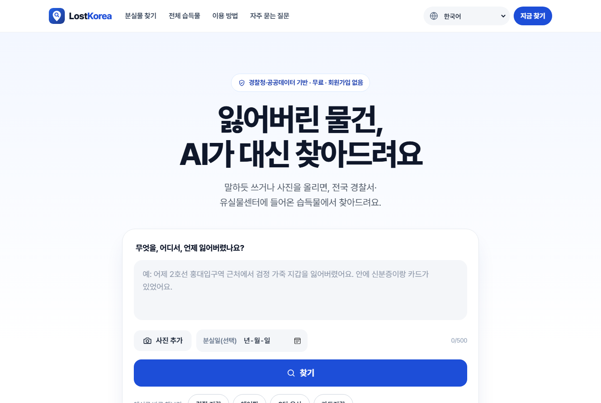
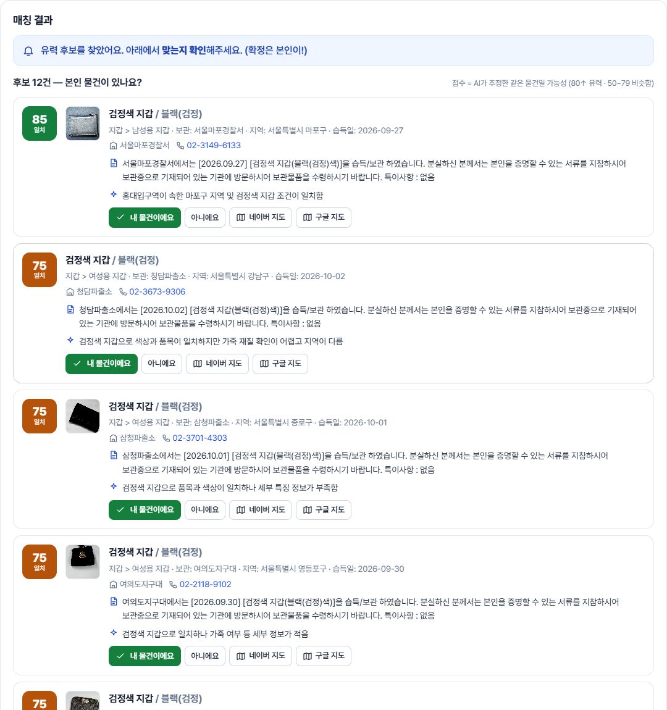
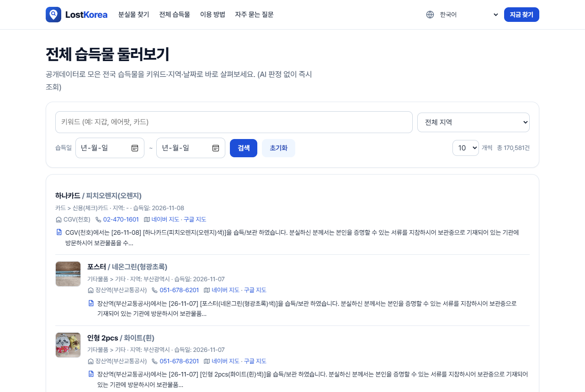
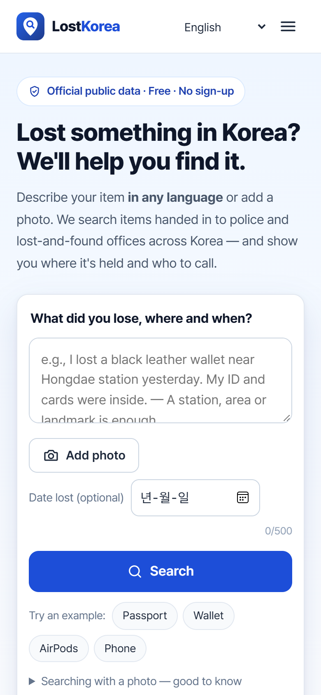
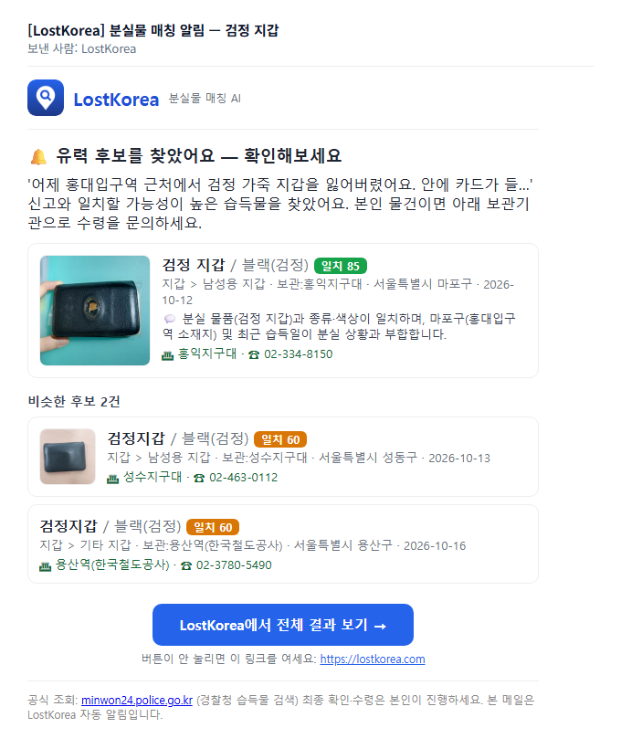
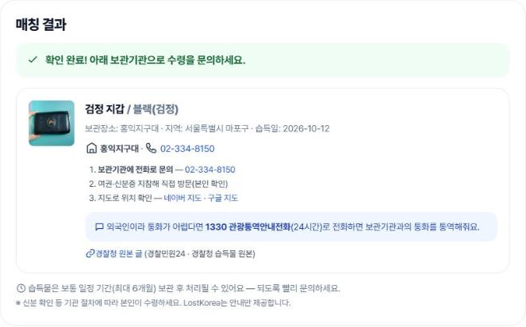

# LostKorea — 한국 분실물 AI 찾기

> 서비스명 변경(2026-11-09): **FindIt → LostKorea** — 같은 이름의 분실물 서비스(AI 매칭 앱 포함)가 이미 여럿 있어 변경.
> GitHub 저장소(`cwal8202/lostkorea`)·DB·컨테이너·서버 경로 등 내부 이름도 lostkorea로(옛 주소는 GitHub가 자동 연결),
> 사이트 주소도 **lostkorea.com**으로(대회용 옛 주소는 새 주소로 자동 이동).

> **해결하는 문제**: 습득물 공개데이터가 있어도 **검색·이용이 불편하다** — 키워드라 표현이 조금만 달라도 못 찾고,
> 매번 직접 뒤져봐야 하며, 잃어버린 장소가 불확실하거나 외국인이면 더 어렵다.

분실물을 **자연어·사진으로** 검색하면, 경찰청·포털 **습득물 공개데이터**에서 **의미 기반(임베딩) + LLM 판정**으로
매칭하고 **근거·수령 안내·알림**까지 주는 서비스. 기존 관공서 검색보다 **더 쉽고 접근성 있게** 분실물을 찾도록.
(외국인 대상 실서비스를 목표로 운영 중 — 코드 품질과 **설계 근거 문서화** 중시)

> 🚀 **라이브**: https://lostkorea.com (영어: [/en](https://lostkorea.com/en))
> — 예: *"어제 서울 2호선에서 검정 지갑 잃어버렸어요"* 검색, **또는 📷 사진 업로드**(Vision 특징추출) →
> 유력 후보 + **근거** + (사진 있으면) 썸네일 → *[내 물건이에요]* 시 보관기관·전화·지도·경찰청 원본 글 안내.
> 🌐 **다국어** — 어떤 언어로 검색해도 결과, 화면·수령안내도 여러 언어(외국인도 이용).
>
> 📄 모든 결정·실험·수치는 [`docs/PROGRESS.md`](docs/PROGRESS.md), 배포는 [`docs/DEPLOY.md`](docs/DEPLOY.md), 서비스화 남은 일은 [`docs/LAUNCH.md`](docs/LAUNCH.md).



*스크린샷은 모두 2026-11-13 운영 사이트를 그대로 캡처(검색 결과·메일은 실제 습득물 데이터, 캡처용 신고는 바로 삭제 — 수령 안내는 확인 처리 없이 화면만).*

---

## 왜 LostKorea? (경찰민원24·lost112 대비)

공식 서비스도 습득물 검색·신고·알림을 한다. LostKorea는 그 **공개데이터 위에, 훨씬 쉽고 정확하게 찾도록 "접근성"을 얹는다**:

- **말하듯 검색 + 의미 매칭** — *"어제 2호선에서 검정 지갑"* 처럼 자연어로. 키워드가 아니라 **뜻**으로 찾아 표현이 달라도·오타·한↔영 커버(BM25 MRR 0.63 → 임베딩 **0.96**).
- **왜 후보인지 근거(LLM) + 📷 사진 검색(Vision)** — 목록만 주는 관공서와 달리 **판단 근거**·사진 대조까지.
  AI가 **무엇을 하는지(추출→지역→검색→판정) 실시간으로 보여주고**, 판정 전 후보부터 먼저 띄움.
- **장소가 불확실해도** — 노선 경유 지역까지 넓혀 순위에 반영하고 *왜* 그 지역들을 봤는지 **설명**.
  버스 번호는 **실제 노선표**(서울 1,353 + 전국 국토부 14,158 + 대구·광주 599, 16,110개 노선의 정류장 → 구)로 — AI 추정보다 정밀도 38% → 98%.
- **안 찾아봐도 알림** — 신고를 저장해두면 새 습득물 유입마다 자동 재매칭 → **이메일 알림**(알림 기간·약한 후보 알림은 사용자가 설정).
  메일 버튼은 **그 신고의 결과로 바로** 열려서 다른 기기에서도 후보 확인·[내 물건이에요]까지 이어짐.
- **지금 보관 중인 것만** — 매일 경찰 목록과 대조해 주인에게 돌아간(종결) 습득물은 빼고, 내려간 사진도 반영.
  전체 습득물은 **사진 있는 것만·오래된순** 보기, 특이사항과 **경찰청 원본 글** 링크까지(조건은 주소에 남아 링크로 공유).
  지역은 **입력하면 바로 걸러지는 목록**으로 고름('부산' → 부산과 그 아래 구·군, 영어 'gangnam'도).
  키워드는 표기가 달라도 찾음('보조밧데리' → 보조배터리, '에어팟' → 경찰이 '무선이어폰'으로만 적은 것까지 — 친 그대로가 먼저).
  사진은 서버가 줄인 **작은 미리보기(원본 ~3MB → ~10KB)**로 — 로밍 중인 휴대폰 데이터 절약. 밤마다 최신 습득물부터 미리 만들어 둬서
  처음 보는 사진도 경찰 서버를 기다리지 않음.
- **다국어(외국인 접근성)** — 관공서는 한국어로만 검색되지만(영어로 치면 0건), LostKorea는 **어떤 언어로 검색해도** 결과 + 화면·수령안내 다국어.
  영어 화면의 지역 이름은 공식 로마자 표기(`Jongno-gu, Seoul`)로, 'jongno'처럼 영어로도 고름.
  습득물도 영어로 — 분류·색·경찰서 이름은 표·규칙, 물품명·특이사항만 수집 때 AI로 한 번(번역 기억, 브랜드·모델 번호 보호, 원문 보기).

> 포지셔닝: 관공서 데이터를 **대체가 아니라 보완** — 더 똑똑한 검색·매칭 + 접근성 레이어. 실제 수령·권리는 관공서 소관 → **HITL(사용자 확인)** 유지.

---

## 📸 화면

| AI 매칭 결과 (일치 점수·근거·보관기관·전화·지도·원본 글) | 전체 습득물 (사진 미리보기·사진 있는 것만·정렬·원본 글) |
|:---:|:---:|
| [](docs/screenshots/ai-match.png) | [](docs/screenshots/browse.png) |
| **영어 화면** (휴대폰 · 외국어 브라우저는 자동 이동) | **알림 메일** (같은 검색 결과로 만든 실제 메일 HTML) |
| [](docs/screenshots/multilingual.png) | [](docs/screenshots/email.png) |

| [내 물건이에요] → 수령 안내 (전화·여권 지참·네이버/구글 지도·1330 통역·경찰청 원본 글) |
|:---:|
| [](docs/screenshots/retrieval.png) |

---

## 현재 상태

**✅ 동작하는 전체 파이프라인** (자연어 신고 → 매칭 → 저장 → 지속 재매칭 → 알림 → 웹)
```
수집기(data.go.kr, 매일 최근 7일 + 경찰 목록 대조 + 늦은 등록 채우기) → OpenSearch 색인 → 검색+지역가점 → LLM grading → 매칭 에이전트(LangGraph)
                                                                                  ↓ (단계별 SSE)
              웹 화면 ← 알림(Notifier·이메일) ← 지속 재매칭 ← 분실물 DB(PostgreSQL / 로컬 SQLite)
```
- **매칭 에이전트**: `POST /lost-items`(자연어 한 줄 → 매칭) · `POST /lost-items/image`(📷 사진 → Vision 특징추출 → 매칭)
  · 웹은 `…/stream`(SSE)으로 **추출 → 지역 → 검색어 → 검색 → 판정을 실시간 표시**(판정 전 후보를 먼저 보여줌)
  · 물건 이름만 짧게 써도(어느 언어든) 신고로 받아 검색 — 인사·잡담·질문·광고·욕설·습득자 글만 거절(123문항×5회 거절 19% → 0%, `eval/results/extract_gate.md`)
- **전체 둘러보기**: `GET /found-items/browse` — 키워드(낱말을 더할수록 좁아짐·다 맞은 것 먼저·색 이름·동의어)·지역(시도→시군구)·날짜·사진 필터 + 최신순·오래된순(임베딩·LLM 없이 즉시)
- **웹**: 홈 첫 화면에서 바로 검색(글·사진) → 실시간 진행 → 매칭 결과(일치 점수·근거·썸네일·보관기관·지도) → HITL 확인 → 수령 안내 → **수령 진행(연락·방문·찾았어요·내 물건 아님)**, 이메일 알림(신고할 때 또는 결과 화면 맨 위 — 확인 메일의 버튼을 한 번 눌러야 켜짐), '내 신고'(이 브라우저) · 전체 습득물(`/browse`) · 영어 가이드(`/en/guide`)
- **다국어**: 어떤 언어로 검색해도 결과(서버가 검색어 번역) + **영어 화면 직접 제공**([/en](https://lostkorea.com/en), 외국어 브라우저는 자동 이동) + 그 밖의 언어는 Google 번역 위젯(필요할 때만 로딩) + **알림 메일·판정 근거·물품명·특이사항도 신고자 언어로**(14개 언어, 장소는 한국어 원문 병기 — 판정과 번역을 나누고 결과 언어를 검사해 섞이면 다시 쓰거나 원문 표시, 6개 언어 측정 섞임 77칸→0). 수령 안내에 네이버·구글 지도와 1330 통역 전화 안내
- **검색·SNS 노출**: 언어별 메타(검색 결과에서 안 잘리는 길이)·hreflang·OG 이미지·JSON-LD(FAQPage 포함), robots.txt·sitemap.xml(수정 날짜 포함), 홈 화면 추가(PWA)
- **웹사이트**: 홈(히어로 검색·데이터 규모·이용 방법·특징·신뢰·FAQ)·전체 습득물·영어 가이드·방침/약관 — 공통 머리글/바닥글, 서버가 언어별로 글자를 채워 그림(`apps/api/site.py`), Pretendard 자체 호스팅, 선 아이콘, 모바일 메뉴
- **지속 재매칭 + 알림**: 신고 저장 → 새 습득물 유입마다 재매칭(유력 후보가 생겨도 '내 물건이에요'·삭제·기간 끝까지 계속 — 다른 유력 후보가 나오면 다시 알림) → 성립 시 **이메일 알림**(로고·매칭 근거·사이트 버튼 포함). 메일은 업체가 받았을 때만 '발송'으로 세고, 실패하면 15분·1시간·6시간·24시간 뒤 다시 보냄.
  신고 폼 또는 결과창 맨 위 **알림**에서 이메일(이중 확인 — 확인 대기·켜짐 단계를 화면에, 확인 링크를 다시 열면 '이미 확인'·'만료'를 바로)·**알림 기간(7~180일, 기본 30일 — 지나면 재매칭 중단)**·**약한 후보(grade 50~79) '참고' 알림** 옵트인을 변경
- **매일 수집(cron 00:00 KST)**: 습득물은 며칠에 걸쳐 등록되므로 **최근 7일 창을 매일 재조회**, 이미 색인된 항목은 건너뛰고
  새 항목만 상세 조회·임베딩 → 색인 → 재매칭. (기존 '어제분'만 조회 시 새 데이터 99% 누락 → 수정, [PROGRESS](docs/PROGRESS.md) 참고)
  경찰 목록과 대조해 종결된 습득물은 지우고 내려간 사진은 반영 — **지우기 전에 이탈 기록**(`found_closures`: 분류·색·장소·사진/특이사항 유무·
  습득일·처음 본 날, 이름·원문 제외)을 남겨 어떤 물건이 얼마나 빨리 목록에서 빠지는지 볼 수 있게.
- **데이터랩 결합 분석**(`eval/datalab/`): 한국관광 데이터랩 외국인 방문자수 × 습득물 10.6만 건(2026.8) → 외국인 방문 상위 20개 시군구(8.7%)에
  **외국인 방문 59.2%·습득물 38.1%** 집중, 분실 지역 ≠ 보관 지역(역·유실물센터 등 거점) 확인 → 경유 지역 확장 검색의 근거
- **보안·개인정보**: 신고마다 관리 토큰(등록 응답으로 1회, 서버엔 해시만) — 확인·제외·알림 설정은 토큰이 있어야 가능.
  공개 신고 목록 없음('내 신고'는 이 브라우저에서만). 알림 이메일은 **확인 링크를 눌러야** 활성화(남의 주소로 못 보냄).
  IP별 레이트리밋 + 하루 AI 사용량 상한, 사진·검색어 크기 상한.
  [개인정보처리방침](https://lostkorea.com/privacy)·[이용약관](https://lostkorea.com/terms) — 사진 미저장,
  신고는 알림 기간 종료 30일 뒤 자동 삭제, '내 신고'에서 즉시 삭제 가능.
- **운영 화면**(`/admin`, 운영자 전용): 들어오면 **이상 항목만 위로**(검색 엔진·새벽 수집·최근 습득일·백업·알림 재발송·디스크·예비 AI 모델·
  AI 상한·앱 오류·로그인 실패, 정상은 한 줄로 접음) → 기간(7·30·90일)별 **신고 대장**(신고 → 유력 후보 → 내 물건 → 연락·방문 → 찾음을
  한 줄씩 20건씩 쪽으로, 줄을 열면 신고 문장·AI가 뽑은 항목·후보 3개·진행 기록, 외국어 신고는 처음 열 때 AI가 한국어로 옮겨 저장 —
  문의가 오면 **신고 문장 낱말·이메일 일부·신고 번호로 찾기**)·방문·신고 접수·메일·AI 비용·
  습득물 이탈 → 지금 상태(남은 신고·색인·이번 달 메일·서버). 숫자는 실제 기록에서만(없는 값은 '기록 없음'·'＊', 어림값은 '≈').
  `.env` `ADMIN_PASSWORD`가 있을 때만 열림(HTTP Basic, 없으면 404, IP당 한 시간 10번 틀리면 429), 신고 문장은 줄을 열 때만 보내고 연 시각을 기록,
  이메일 주소는 싣지 않음.
- **비용·장애 대비**: 재매칭은 상위 후보가 바뀐 신고만 LLM 판정. 숨은 thinking 토큰 제거(실측: 신고 1건 출력 토큰의 80% · 응답 16.9초→6.3초, 품질 동일), 같은 장소 노선 캐시. Gemini 장애 시 키워드(BM25) 검색으로 대체, 모델이 종료되거나 하루 요청 한도(모델별)를 넘으면 예비 모델로 자동 전환(관리자 알림).

**✅ 검색 품질 실측 (eval, 골든셋 29문항)**

| 방식 | R@1 | R@5 | MRR |
|------|:---:|:---:|:---:|
| BM25 (nori) | 0.517 | 0.793 | 0.633 |
| **의미 임베딩 (KNN)** | **0.931** | **1.000** | **0.960** |

→ 의미 임베딩이 주력 랭커(한글↔영문·번역·오타 커버). **지역 가점**은 밀집 군집(검정지갑 193건 등)에서
묻힌 정답을 MRR 0.084→0.857로 끌어올림(덧셈 소프트 w≈0.05, eval 검증). 보관장소→구/시는 지명 사전(낱말 경계 규칙) + 카카오 장소 검색 캐시로 해석 — 운영 색인의 **99.4%**에 지역(2026-11-15 전수 점검·수정).

**검색어는 한 문장**: 브랜드·색·물건·특징을 검색어 하나로 — 좁게·중간·넓게 3개를 합치던 예전 방식은 넓은 검색어의 평범한 물건이
정답을 밀어내 정답 1위 72% → 한 문장 89%(123문항, `eval/results/merge_compare.md`). 정답이 상위 8개 안에 99%라 AI 판정도 8개만(-29% 비용).
판정은 점수 전에 장소·날짜가 이어지는지 먼저 적고, 둘 다 어긋난 후보는 유력 알림을 보내지 않음 — 실제 분실 신고 300건에서
다른 물건인데 유력 알림 대상이던 후보 43 → 9(`eval/results/langfix_grade.md`).

**실제 분실 신고 300건**(경찰청 LOST112, 주인이 직접 낸 신고 — 특이사항은 가려진 채): 같은 물건으로 보이는 습득물이 이미 보관 중이던
신고 46건(15%) 중 67%를 1위로(3위 안 83%) 찾음. 브랜드·모델·여권 국적처럼 양쪽에 적힌 특징까지 맞는 보수적 하한은 16건(5%), 그중 1위 12건.
영·중·일 문장으로는 하한 16건 중 12~15건(`eval/results/lost112.md`·`lost112_lang.md`, 판정은 AI라 정답 아님).

**✅ 테스트**: `uv run pytest` — 핵심 로직 488개(운영 화면 인증·신고 대장·번역 저장·검색어 만들기·지역가점·지역 매칭·버스 노선표 경유 지역·store 생애주기·정규화·notifier·약한 후보 알림·알림 기간·이메일 확인·수집기·경찰 목록 대조·습득물 이탈 기록·메일 결과 링크·실시간 스트림·다국어 메일·6개 언어 결과 언어 검사·분실일 거름·보관장소 지역 해석·알림 재발송·수령 진행 기록·신고 문장 개인정보 가림·보안·레이트리밋(Cloudflare 경유 실제 IP)·운영 점검·개인정보 삭제·장애 대비·운영 관측·한영 화면·검색 노출·AI 비용·웹 페이지·API), 외부서비스 불필요(목킹).

**⏳ 남은 것**: 운영자 결정·계정이 필요한 일(정식 도메인·검색엔진 등록·Gemini 유료 등급·개인정보 보호책임자 — [`docs/LAUNCH.md`](docs/LAUNCH.md)) ·
카카오 알림톡(사업자 필요) · 이미지 임베딩(CLIP) 검색 · 인증(user_id) · 브라우저 확장.

---

## 아키텍처 원칙 (핵심)

- **채널 독립 코어** — 비즈니스 로직에 카카오/웹 의존성 금지. 알림은 `Notifier` 인터페이스로만.
- **장소·특징은 하드필터가 아니라 가점(boosting)** — 조건은 정답을 좁히는 게 아니라 순위를 정하는 점수. 시간만 예외: 분실일을 적으면 그 전날 이후 습득물만 찾음(185일치에서 비슷한 순으로만 뽑으면 분실일 이후 물건이 후보에 거의 안 들어옴).
- **되돌릴 수 없는 액션(공식 신고)은 HITL** — 자동화 금지, 사용자 승인 유지.
- **공공 API 필드는 `fixtures/responses/` 샘플이 진실** — 추측으로 필드명 만들지 않음.

## 기술 스택

Python 3.12 · FastAPI · LangGraph · Gemini API(embedding·grading·**Vision 이미지 추출**·검색어 번역) ·
OpenSearch(nori, 768-dim HNSW KNN) · PostgreSQL(배포) / SQLite(로컬) · 서버 렌더링 페이지(한/영) + 바닐라 JS(**SSE 실시간 진행**) + Pretendard ·
Docker Compose · **Caddy(자동 HTTPS)** · **GitHub Actions(자동배포)** · pytest · uv · ruff

## 레포 구조

```
eval/        골든셋 + 성능 실험 (BM25/임베딩/하이브리드/스윕, OpenSearch 색인·검색·데모, 결과 번역 6개 언어 측정 run_lang·분실일 거름 측정 run_date·버스 경유 구 대조 run_route_bus·실제 분실 신고 실측 run_lost112) + datalab/(데이터랩 결합 분석)
infra/       로컬 docker-compose + OpenSearch(nori) Dockerfile + 인덱스 매핑 + Caddyfile(프로덕션 HTTPS)
fixtures/    공공 API 실응답 샘플 (진실의 원천)
scripts/     daily_collect.sh(cron 일일 수집) · backup_db.sh(일일 DB 백업 — 서버 + 암호화해 Cloudflare R2) · restore_test.sh(복구 시험) · migrate_rename.sh(1회용 이름 이전) · region 백필/지오코딩·지역 해석 캐시(build_geocode_cache) · build_bus_routes(버스 노선표, 월 1회 로컬)
tests/       pytest 488개 (외부 서비스 목킹)
docs/        PROGRESS.md (설계·실험·결정 기록) · DEPLOY.md (배포·운영) · LAUNCH.md (서비스화 체크리스트) · screenshots/
apps/api/       FastAPI — 신고·검색·알림 API(/lost-items[/stream, /image], /found-items/search·/browse, /alerts·/confirm·/dismiss·삭제,
                /email/verify, /health[/deep]) + 레이트리밋·AI 상한(limits.py) + Gemini(gemini.py) + 지역 매칭(region.py)
apps/agent/     매칭 에이전트 (LangGraph: extract→route(버스 번호는 노선표, 나머지 Gemini)→fanout(검색어 한 문장)→search→grade(상위 8), 단계 스트림) + rematch(지속 재매칭·알림 기간)
apps/collector/ 수집기 (data.go.kr 목록 → 기존 항목 스킵 → 새 항목 상세 enrich → 임베딩 → 색인, --rematch)
apps/store.py   분실물 저장소 (PostgreSQL/SQLite 이중 백엔드, DATABASE_URL로 선택, 누락 컬럼 자동 마이그레이션) + 익명 통계 + 습득물 이탈 기록
apps/notifier.py 알림 (Notifier 인터페이스 + Console/Email, 유력·약한 후보 문구 구분, 신고자 언어 13개)
apps/ops.py     운영 점검·알림 (오류 메일·데이터 정체·주간 요약·AI 토큰 실사용)
apps/api/site.py  웹 페이지(홈·전체 습득물·가이드·방침·약관·robots·sitemap) — 언어별 서버 렌더링
apps/api/admin.py 운영 화면(/admin·/admin/data·/admin/reports/{id}[/ko]) — ADMIN_PASSWORD 인증, 실제 기록만 읽음
apps/web/       템플릿(index·문서 페이지·partials 머리글/바닥글·admin.html 운영 화면) + static(css·js·폰트·로고·OG)
```
> `apps/extension`(브라우저 확장)은 다음 단계 예정.

## 실행

**1. 사전 준비**: Docker Desktop, [uv](https://docs.astral.sh/uv/), `.env` 작성 ([`.env.example`](.env.example) 참고)
```bash
uv sync   # .venv + 의존성(fastapi/uvicorn/langgraph 등)
```

**2. OpenSearch(nori) 기동 + 인덱스**
```bash
docker compose -f infra/docker-compose.yml up -d --build
curl -X PUT localhost:9200/found_items -H "Content-Type: application/json" \
  --data-binary @infra/opensearch/mappings/found_items.json      # 최초 1회
python eval/index_opensearch.py                                   # 캐시 임베딩으로 시드 색인(선택)
```

**3. 앱(API+웹) 실행** → 브라우저에서 http://localhost:8000
```bash
uv run uvicorn apps.api.main:app --reload      # /docs 에 API 문서
```

**4. 수집기 (실 데이터 갱신, 선택)** — 스케줄과 무관한 CLI. 이미 색인된 항목은 건너뛰고, 색인 후 지속 재매칭까지:
```bash
uv run python -m apps.collector.run --source both --start 20260901 --end 20260907 --rows 1000 --max 20000 --enrich --rematch
```
> 상세 조회(항목당 1콜, 일 10만 한도)·임베딩은 새 항목에만 쓰임. 처음엔 기간을 짧게 해 비용을 확인하세요.

**성능 실험(eval)**: `python eval/run_os.py`(OpenSearch 실측) · `python eval/run_boost.py`(지역 가점) ·
`python eval/run_grade.py`(LLM grading). 상세는 [`docs/PROGRESS.md`](docs/PROGRESS.md).

**데이터랩 결합 분석**(공공데이터포털 `한국관광공사_빅데이터_지역별 방문자수` 활용신청 필요):
```bash
uv run python -m eval.datalab.fetch_datalab --start 20260801 --end 20260830   # 데이터랩 방문자수
uv run python -m eval.datalab.fetch_found   --start 20260801 --end 20260830   # 같은 기간 습득물 시군구 집계
uv run python -m eval.datalab.analyze --period 20260801_20260830              # 결합 분석 → data/analysis_*
uv run --with matplotlib python -m eval.datalab.charts --period 20260801_20260830  # 차트 → figures/
```

> Windows에서 콘솔 한글/이모지 깨짐 방지: `PYTHONUTF8=1` 권장.

---

*설계 결정의 배경과 모든 실험 수치는 [`docs/PROGRESS.md`](docs/PROGRESS.md)를 참고하세요.*
